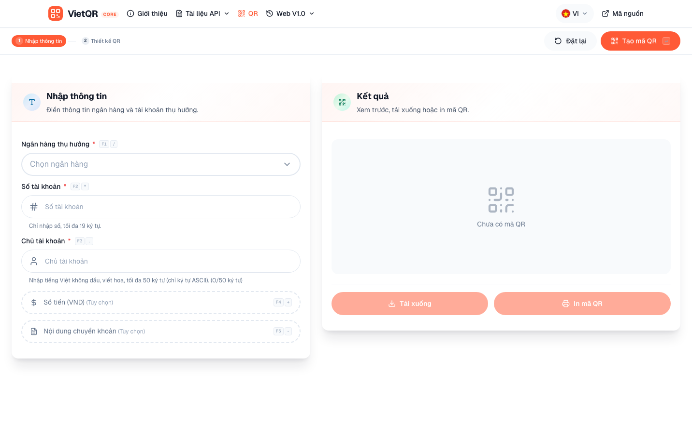

# VietQR Core

Self-hosted Vietnamese bank-transfer QR generator with a polished web UI and a JSON API. One Go binary, embedded assets, no external services.

> **Why this exists:** VietQR's hosted "API Generate" service will be discontinued on **01/01/2027**. VietQR Core replaces it with an EMVCo/NAPAS 247 encoder that runs entirely on your own server.

<p align="center">
  <a href="#english">English</a> · <a href="#vietnamese">Tiếng Việt</a>
</p>



<a id="english"></a>

## English

### Features

- **Web UI:** bank picker, inline validation, amount/message options, QR preview, PNG/SVG download, print, and design themes.
- **VietQR payloads:** EMVCo/NAPAS 247 encoding with CRC checksum, built on [`github.com/sunary/vietqr`](https://github.com/sunary/vietqr).
- **63 banks:** search by code, BIN, VietQR code, short name, or full name.
- **Image API:** cached PNG and SVG QR images with ETag support.
- **Decode API:** inspect an existing VietQR transfer payload.
- **Single binary:** HTML, CSS, JS, fonts, and bank logos are embedded with `embed.FS`.
- **Responsive:** desktop and mobile layouts, Vietnamese interface, keyboard shortcuts.
- **Safe defaults:** CSP, `nosniff`, `no-referrer`, `noindex`, strict JSON parsing, request size limits, graceful shutdown.

### Requirements

- Go **1.22** or newer.
- No Node.js, database, or external API keys.

### Quick start

```bash
git clone https://github.com/puarudz/vietqr-golang.git
cd vietqr-golang
go run .
```

Open <http://localhost:8080>.

Use a different address or port:

```bash
go run . -addr :41126
PORT=41126 go run .
ADDR=127.0.0.1:41126 go run .
```

On Windows PowerShell:

```powershell
$env:PORT = "41126"
go run .
```

Configuration precedence:

| Setting | Example | Notes |
| --- | --- | --- |
| `-addr` flag | `./vietqr-core -addr :41126` | Highest precedence |
| `ADDR` | `ADDR=127.0.0.1:41126` | Used when `-addr` is omitted |
| `PORT` | `PORT=41126` | A leading `:` is added automatically |
| Default | `:8080` | Used when nothing is set |

### Build

Native production build:

```bash
CGO_ENABLED=0 go build \
  -trimpath \
  -ldflags "-s -w -X main.version=1.0.0" \
  -o vietqr-core .
```

Run it:

```bash
./vietqr-core -addr :41126
```

#### Cross-compile Linux, Windows, and macOS

```bash
mkdir -p dist
for target in linux/amd64 linux/arm64 windows/amd64 windows/arm64 darwin/amd64 darwin/arm64; do
  os="${target%/*}"
  arch="${target#*/}"
  out="dist/vietqr-core-${os}-${arch}"
  [ "$os" = "windows" ] && out="${out}.exe"
  CGO_ENABLED=0 GOOS="$os" GOARCH="$arch" \
    go build -trimpath -ldflags "-s -w -X main.version=1.0.0" -o "$out" .
done
```

Outputs:

| OS | Architecture | File |
| --- | --- | --- |
| Linux | x86-64 | `dist/vietqr-core-linux-amd64` |
| Linux | ARM64 | `dist/vietqr-core-linux-arm64` |
| Windows | x86-64 | `dist/vietqr-core-windows-amd64.exe` |
| Windows | ARM64 | `dist/vietqr-core-windows-arm64.exe` |
| macOS | Intel | `dist/vietqr-core-darwin-amd64` |
| macOS | Apple Silicon | `dist/vietqr-core-darwin-arm64` |

The binaries are statically linked and do not require Go on the target machine.

### Web UI

1. Choose the beneficiary bank.
2. Enter the account number.
3. Enter the account holder name.
4. Optionally add an amount and a transfer message.
5. Press **Tạo mã QR** to generate the QR and ticket.
6. Download PNG/SVG, copy the image link or payload, print, or change the ticket theme.

Keyboard shortcuts:

| Key | Action |
| --- | --- |
| `F1` | Open the bank picker |
| `F2` | Focus the account number |
| `F3` | Focus the account holder name |
| `F4` | Expand the amount field |
| `F5` | Expand the message field |
| `Esc` | Close the download menu or an open dialog |

Notes:

- The UI sanitizes the account holder name to uppercase ASCII; the API accepts Unicode up to 50 characters.
- The amount is limited to 12 digits, matching the API limit.
- Design themes affect the on-screen and printed ticket only. The QR image itself stays plain black and white.
- `accountName` is display data. It is **not** embedded in the EMVCo payload; the receiving bank resolves the holder name from the account number.

### API

Default base URL: `http://localhost:8080`.

All `/api/*` responses include permissive CORS headers (`Access-Control-Allow-Origin: *`). `OPTIONS` requests return `204 No Content`.

Errors use a consistent JSON shape:

```json
{
  "error": "Số tài khoản phải từ 3 đến 19 ký tự.",
  "field": "account"
}
```

`field` is omitted when the error is not tied to a specific input. Error messages are in Vietnamese.

| Method | Path | Description |
| --- | --- | --- |
| `GET` | `/api/banks` | Supported bank catalog |
| `POST` | `/api/qr` | Build a VietQR payload and return image URLs |
| `GET` | `/api/qr.png` | Render a PNG QR code |
| `GET` | `/api/qr.svg` | Render an SVG QR code |
| `GET` | `/api/decode` | Decode a VietQR payload |
| `GET` | `/healthz` | Health and version check |

#### `POST /api/qr`

Request body:

| Field | Type | Required | Description |
| --- | --- | --- | --- |
| `bank` | string | Yes | Bank code, BIN, VietQR code, short name, or full name |
| `account` | string | Yes | 3–19 ASCII letters/digits; spaces, `.`, `-`, `_` are ignored |
| `accountName` | string | No | Up to 50 characters; returned for display, not encoded into the payload |
| `amount` | integer | No | `0`–`999999999999` VND; `0` or omitted means the recipient enters the amount |
| `message` | string | No | Up to 50 Unicode characters |

The body is limited to 64 KiB, must contain exactly one JSON object, and unknown fields are rejected.

```bash
curl -s http://localhost:8080/api/qr \
  -H 'Content-Type: application/json' \
  -d '{
    "bank": "VIETCOMBANK",
    "account": "9876543210",
    "accountName": "NGUYEN VAN A",
    "amount": 100000,
    "message": "Thanh toan don hang"
  }'
```

Response:

```json
{
  "payload": "00020101021238540010A00000072701240006970436011098765432100208QRIBFTTA530370454061000005802VN62230819Thanh toan don hang630458F9",
  "bank": {
    "code": "VIETCOMBANK",
    "bin": "970436",
    "vietqrCode": "VCB",
    "shortName": "Vietcombank",
    "name": "Ngân hàng TMCP Ngoại Thương Việt Nam",
    "logo": "/assets/logos/VIETCOMBANK.png"
  },
  "account": "9876543210",
  "accountName": "NGUYEN VAN A",
  "amount": 100000,
  "message": "Thanh toan don hang",
  "qr": {
    "png": "/api/qr.png?account=9876543210&amount=100000&bank=VIETCOMBANK&message=Thanh+toan+don+hang&size=1024",
    "svg": "/api/qr.svg?account=9876543210&amount=100000&bank=VIETCOMBANK&message=Thanh+toan+don+hang"
  }
}
```

`accountName` is omitted from the response when empty. The `qr.png` link returned by `POST` uses `size=1024`; the SVG link uses the default size.

#### `GET /api/qr.png` and `GET /api/qr.svg`

Query parameters:

| Param | Required | Description |
| --- | --- | --- |
| `bank` | Yes | Bank code, BIN, VietQR code, short name, or full name |
| `account` | Yes | 3–19 ASCII letters/digits |
| `amount` | No | Amount in VND |
| `message` | No | Transfer message, up to 50 characters |
| `size` | No | Image size in pixels, `256`–`2048`; default `720` |

```bash
curl -o qr.png \
  "http://localhost:8080/api/qr.png?bank=VIETCOMBANK&account=9876543210&amount=100000&size=1024"

curl -o qr.svg \
  "http://localhost:8080/api/qr.svg?bank=VIETCOMBANK&account=9876543210&size=512"
```

Responses use `Content-Type: image/png` or `image/svg+xml; charset=utf-8`, `Cache-Control: public, max-age=86400`, and a strong `ETag`. Send `If-None-Match` to receive `304 Not Modified` instead of the image.

Images contain only the QR code: no logos, bank branding, or ticket theme.

#### `GET /api/decode`

| Param | Required | Description |
| --- | --- | --- |
| `payload` | Yes | VietQR payload to decode |

```bash
curl -sG http://localhost:8080/api/decode \
  --data-urlencode "payload=00020101021238540010A00000072701240006970436011098765432100208QRIBFTTA530370454061000005802VN62230819Thanh toan don hang630458F9"
```

Response:

```json
{
  "payload": "00020101021238540010A00000072701240006970436011098765432100208QRIBFTTA530370454061000005802VN62230819Thanh toan don hang630458F9",
  "bank": {
    "code": "VIETCOMBANK",
    "bin": "970436",
    "vietqrCode": "VCB",
    "shortName": "Vietcombank",
    "name": "Ngân hàng TMCP Ngoại Thương Việt Nam",
    "logo": "/assets/logos/VIETCOMBANK.png"
  },
  "account": "9876543210",
  "amount": 100000,
  "message": "Thanh toan don hang"
}
```

Only transfer-to-account VietQR payloads are supported. Payloads must be 24–1024 characters and pass the CRC check. Invalid payloads return `400` with `"field": "payload"`.

#### `GET /api/banks`

```json
{
  "count": 63,
  "banks": [
    {
      "code": "VIETCOMBANK",
      "bin": "970436",
      "vietqrCode": "VCB",
      "shortName": "Vietcombank",
      "name": "Ngân hàng TMCP Ngoại Thương Việt Nam",
      "logo": "/assets/logos/VIETCOMBANK.png"
    }
  ]
}
```

Bank lookup is case-insensitive and ignores spaces, `.`, `-`, `_`, and `/`. A bank can be referenced by `code`, `bin`, `vietqrCode`, `shortName`, or `name`. The response is cached for one hour.

#### `GET /healthz`

```json
{
  "status": "ok",
  "version": "1.0.0"
}
```

### Limits and validation

| Item | Limit |
| --- | --- |
| Account number | 3–19 ASCII letters/digits after removing spaces, `.`, `-`, `_` |
| Account holder name | 50 characters (display only) |
| Amount | 0–999,999,999,999 VND |
| Transfer message | 50 Unicode characters |
| PNG/SVG size | 256–2048 px, default 720 |
| Decode payload | 24–1024 characters |
| JSON body | 64 KiB, one object, no unknown fields |
| Supported banks | 63 |

Validation errors return HTTP `400` and include the offending `field`.

### Privacy and security

- **Stateless:** no database, no accounts, no stored transfers.
- **Local encoding:** the server never calls VietQR, NAPAS, or any external API.
- **Minimal logs:** API requests log method, path, status, and duration only. Bodies and query strings are not logged.
- **Hardened responses:** CSP, `X-Content-Type-Options: nosniff`, `Referrer-Policy: no-referrer`, `X-Robots-Tag: noindex, nofollow`, and a `robots.txt` that disallows crawling.
- **CORS:** `/api/*` is open to any origin by design. Restrict it at a reverse proxy if you need to.
- The image API is an encoder, not a payment processor. It does not confirm that an account exists.

There is no built-in authentication or rate limiting. If you expose the service publicly, put it behind a reverse proxy and add rate limiting and access controls as needed.

### Deployment

Example `systemd` unit:

```bash
sudo groupadd --system vietqr
sudo useradd --system --gid vietqr --no-create-home --shell /usr/sbin/nologin vietqr
```

```ini
# /etc/systemd/system/vietqr-core.service
[Unit]
Description=VietQR Core
After=network-online.target
Wants=network-online.target

[Service]
Type=simple
User=vietqr
Group=vietqr
WorkingDirectory=/opt/vietqr-core
ExecStart=/opt/vietqr-core/vietqr-core -addr 127.0.0.1:41126
Restart=on-failure
RestartSec=2

[Install]
WantedBy=multi-user.target
```

```bash
sudo systemctl daemon-reload
sudo systemctl enable --now vietqr-core
```

Behind nginx:

```nginx
server {
    listen 80;
    server_name qr.example.com;

    location / {
        proxy_pass http://127.0.0.1:41126;
        proxy_set_header Host $host;
        proxy_set_header X-Forwarded-For $proxy_add_x_forwarded_for;
        proxy_set_header X-Forwarded-Proto $scheme;
    }
}
```

### Project layout

```text
.
├── main.go        # flags, embedded assets, HTTP server, graceful shutdown
├── server.go      # routes, handlers, caching, CORS, security headers
├── qr.go          # payload encoding, PNG/SVG rendering, guarded decode
├── validate.go    # normalization and input validation
├── banks.go       # 63-bank catalog and lookup index
└── web/           # embedded UI: HTML, CSS, JS, fonts, bank logos
```

### Credits and disclaimer

- VietQR encoding: [`github.com/sunary/vietqr`](https://github.com/sunary/vietqr)
- QR rendering: [`github.com/skip2/go-qrcode`](https://github.com/skip2/go-qrcode)
- Geist and Geist Mono fonts: SIL Open Font License, see [`web/fonts/OFL.txt`](web/fonts/OFL.txt)
- Bank names, logos, VietQR, and NAPAS are trademarks of their respective owners. This project is not affiliated with or endorsed by them.
- Always verify QR payloads with your bank before using them in production. This project does not move money and is not financial advice.

---

<a id="vietnamese"></a>

## Tiếng Việt

### Tính năng

- **Giao diện web:** chọn ngân hàng, kiểm tra dữ liệu ngay trên form, tùy chọn số tiền/nội dung, xem trước QR, tải PNG/SVG, in và đổi màu thẻ.
- **Payload VietQR:** mã hóa EMVCo/NAPAS 247 kèm checksum CRC, dùng thư viện [`github.com/sunary/vietqr`](https://github.com/sunary/vietqr).
- **63 ngân hàng:** tìm theo mã, BIN, mã VietQR, tên viết tắt hoặc tên đầy đủ.
- **API ảnh:** trả PNG và SVG có cache, hỗ trợ ETag.
- **API giải mã:** đọc payload VietQR chuyển khoản có sẵn.
- **Một binary duy nhất:** HTML, CSS, JS, font và logo ngân hàng được nhúng bằng `embed.FS`.
- **Responsive:** giao diện tiếng Việt cho desktop và mobile, có phím tắt.
- **Mặc định an toàn:** CSP, `nosniff`, `no-referrer`, `noindex`, kiểm tra JSON chặt chẽ, giới hạn kích thước request, tắt server sạch sẽ.

### Yêu cầu

- Go **1.22** trở lên.
- Không cần Node.js, cơ sở dữ liệu hay API key bên ngoài.

### Chạy nhanh

```bash
git clone https://github.com/puarudz/vietqr-golang.git
cd vietqr-golang
go run .
```

Mở <http://localhost:8080>.

Đổi địa chỉ hoặc cổng:

```bash
go run . -addr :41126
PORT=41126 go run .
ADDR=127.0.0.1:41126 go run .
```

Trên Windows PowerShell:

```powershell
$env:PORT = "41126"
go run .
```

Thứ tự ưu tiên cấu hình:

| Cấu hình | Ví dụ | Ghi chú |
| --- | --- | --- |
| Cờ `-addr` | `./vietqr-core -addr :41126` | Ưu tiên cao nhất |
| `ADDR` | `ADDR=127.0.0.1:41126` | Dùng khi không có `-addr` |
| `PORT` | `PORT=41126` | Tự thêm dấu `:` nếu thiếu |
| Mặc định | `:8080` | Dùng khi không cấu hình gì |

### Build

Build production cho máy hiện tại:

```bash
CGO_ENABLED=0 go build \
  -trimpath \
  -ldflags "-s -w -X main.version=1.0.0" \
  -o vietqr-core .
```

Chạy:

```bash
./vietqr-core -addr :41126
```

#### Cross-compile cho Linux, Windows và macOS

```bash
mkdir -p dist
for target in linux/amd64 linux/arm64 windows/amd64 windows/arm64 darwin/amd64 darwin/arm64; do
  os="${target%/*}"
  arch="${target#*/}"
  out="dist/vietqr-core-${os}-${arch}"
  [ "$os" = "windows" ] && out="${out}.exe"
  CGO_ENABLED=0 GOOS="$os" GOARCH="$arch" \
    go build -trimpath -ldflags "-s -w -X main.version=1.0.0" -o "$out" .
done
```

Kết quả:

| Hệ điều hành | Kiến trúc | Tệp |
| --- | --- | --- |
| Linux | x86-64 | `dist/vietqr-core-linux-amd64` |
| Linux | ARM64 | `dist/vietqr-core-linux-arm64` |
| Windows | x86-64 | `dist/vietqr-core-windows-amd64.exe` |
| Windows | ARM64 | `dist/vietqr-core-windows-arm64.exe` |
| macOS | Intel | `dist/vietqr-core-darwin-amd64` |
| macOS | Apple Silicon | `dist/vietqr-core-darwin-arm64` |

Các binary được liên kết tĩnh, không cần cài Go trên máy đích.

### Giao diện web

1. Chọn ngân hàng thụ hưởng.
2. Nhập số tài khoản.
3. Nhập tên chủ tài khoản.
4. Thêm số tiền và nội dung chuyển khoản nếu cần.
5. Bấm **Tạo mã QR** để tạo QR và thẻ chuyển khoản.
6. Tải PNG/SVG, sao chép liên kết ảnh hoặc payload, in, hoặc đổi màu thẻ.

Phím tắt:

| Phím | Thao tác |
| --- | --- |
| `F1` | Mở danh sách ngân hàng |
| `F2` | Chuyển tới ô số tài khoản |
| `F3` | Chuyển tới ô chủ tài khoản |
| `F4` | Mở ô số tiền |
| `F5` | Mở ô nội dung chuyển khoản |
| `Esc` | Đóng menu tải xuống hoặc hộp thoại đang mở |

Lưu ý:

- Giao diện tự chuyển tên chủ tài khoản thành chữ in hoa không dấu; API vẫn chấp nhận Unicode tối đa 50 ký tự.
- Ô số tiền giới hạn 12 chữ số, khớp với giới hạn của API.
- Màu thẻ chỉ ảnh hưởng đến phần xem trước và bản in. Ảnh QR luôn là đen trắng.
- `accountName` chỉ dùng để hiển thị, **không** được nhúng vào payload EMVCo; ngân hàng nhận sẽ tự tra tên chủ tài khoản từ số tài khoản.

### API

Base URL mặc định: `http://localhost:8080`.

Mọi phản hồi `/api/*` có CORS mở (`Access-Control-Allow-Origin: *`). Request `OPTIONS` trả `204 No Content`.

Lỗi luôn có cùng cấu trúc JSON:

```json
{
  "error": "Số tài khoản phải từ 3 đến 19 ký tự.",
  "field": "account"
}
```

`field` sẽ không có nếu lỗi không gắn với một ô nhập cụ thể. Nội dung lỗi bằng tiếng Việt.

| Method | Đường dẫn | Mô tả |
| --- | --- | --- |
| `GET` | `/api/banks` | Danh sách ngân hàng hỗ trợ |
| `POST` | `/api/qr` | Tạo payload VietQR và trả về URL ảnh |
| `GET` | `/api/qr.png` | Trả ảnh QR định dạng PNG |
| `GET` | `/api/qr.svg` | Trả ảnh QR định dạng SVG |
| `GET` | `/api/decode` | Giải mã payload VietQR |
| `GET` | `/healthz` | Kiểm tra trạng thái và phiên bản |

#### `POST /api/qr`

Body:

| Trường | Kiểu | Bắt buộc | Mô tả |
| --- | --- | --- | --- |
| `bank` | string | Có | Mã ngân hàng, BIN, mã VietQR, tên viết tắt hoặc tên đầy đủ |
| `account` | string | Có | 3–19 chữ/số ASCII; tự bỏ dấu cách, `.`, `-`, `_` |
| `accountName` | string | Không | Tối đa 50 ký tự; chỉ dùng để hiển thị, không nhúng vào payload |
| `amount` | integer | Không | `0`–`999999999999` VND; `0` hoặc bỏ trống nghĩa là người nhận tự nhập số tiền |
| `message` | string | Không | Tối đa 50 ký tự Unicode |

Body tối đa 64 KiB, phải chứa đúng một object JSON và không được có trường lạ.

```bash
curl -s http://localhost:8080/api/qr \
  -H 'Content-Type: application/json' \
  -d '{
    "bank": "VIETCOMBANK",
    "account": "9876543210",
    "accountName": "NGUYEN VAN A",
    "amount": 100000,
    "message": "Thanh toan don hang"
  }'
```

Phản hồi:

```json
{
  "payload": "00020101021238540010A00000072701240006970436011098765432100208QRIBFTTA530370454061000005802VN62230819Thanh toan don hang630458F9",
  "bank": {
    "code": "VIETCOMBANK",
    "bin": "970436",
    "vietqrCode": "VCB",
    "shortName": "Vietcombank",
    "name": "Ngân hàng TMCP Ngoại Thương Việt Nam",
    "logo": "/assets/logos/VIETCOMBANK.png"
  },
  "account": "9876543210",
  "accountName": "NGUYEN VAN A",
  "amount": 100000,
  "message": "Thanh toan don hang",
  "qr": {
    "png": "/api/qr.png?account=9876543210&amount=100000&bank=VIETCOMBANK&message=Thanh+toan+don+hang&size=1024",
    "svg": "/api/qr.svg?account=9876543210&amount=100000&bank=VIETCOMBANK&message=Thanh+toan+don+hang"
  }
}
```

`accountName` sẽ không có trong phản hồi nếu để trống. Liên kết `qr.png` do `POST` trả về dùng `size=1024`; liên kết SVG dùng kích thước mặc định.

#### `GET /api/qr.png` và `GET /api/qr.svg`

Tham số query:

| Tham số | Bắt buộc | Mô tả |
| --- | --- | --- |
| `bank` | Có | Mã ngân hàng, BIN, mã VietQR, tên viết tắt hoặc tên đầy đủ |
| `account` | Có | 3–19 chữ/số ASCII |
| `amount` | Không | Số tiền VND |
| `message` | Không | Nội dung chuyển khoản, tối đa 50 ký tự |
| `size` | Không | Kích thước ảnh `256`–`2048` px; mặc định `720` |

```bash
curl -o qr.png \
  "http://localhost:8080/api/qr.png?bank=VIETCOMBANK&account=9876543210&amount=100000&size=1024"

curl -o qr.svg \
  "http://localhost:8080/api/qr.svg?bank=VIETCOMBANK&account=9876543210&size=512"
```

Phản hồi có `Content-Type: image/png` hoặc `image/svg+xml; charset=utf-8`, `Cache-Control: public, max-age=86400` và `ETag`. Gửi `If-None-Match` để nhận `304 Not Modified` thay vì tải lại ảnh.

Ảnh chỉ chứa mã QR: không có logo, thương hiệu ngân hàng hay màu thẻ.

#### `GET /api/decode`

| Tham số | Bắt buộc | Mô tả |
| --- | --- | --- |
| `payload` | Có | Payload VietQR cần giải mã |

```bash
curl -sG http://localhost:8080/api/decode \
  --data-urlencode "payload=00020101021238540010A00000072701240006970436011098765432100208QRIBFTTA530370454061000005802VN62230819Thanh toan don hang630458F9"
```

Phản hồi:

```json
{
  "payload": "00020101021238540010A00000072701240006970436011098765432100208QRIBFTTA530370454061000005802VN62230819Thanh toan don hang630458F9",
  "bank": {
    "code": "VIETCOMBANK",
    "bin": "970436",
    "vietqrCode": "VCB",
    "shortName": "Vietcombank",
    "name": "Ngân hàng TMCP Ngoại Thương Việt Nam",
    "logo": "/assets/logos/VIETCOMBANK.png"
  },
  "account": "9876543210",
  "amount": 100000,
  "message": "Thanh toan don hang"
}
```

Chỉ hỗ trợ payload VietQR chuyển khoản đến tài khoản. Payload phải dài 24–1024 ký tự và vượt qua kiểm tra CRC. Payload không hợp lệ trả `400` với `"field": "payload"`.

#### `GET /api/banks`

```json
{
  "count": 63,
  "banks": [
    {
      "code": "VIETCOMBANK",
      "bin": "970436",
      "vietqrCode": "VCB",
      "shortName": "Vietcombank",
      "name": "Ngân hàng TMCP Ngoại Thương Việt Nam",
      "logo": "/assets/logos/VIETCOMBANK.png"
    }
  ]
}
```

Tìm ngân hàng không phân biệt hoa thường và bỏ qua dấu cách, `.`, `-`, `_`, `/`. Có thể dùng `code`, `bin`, `vietqrCode`, `shortName` hoặc `name`. Phản hồi được cache 1 giờ.

#### `GET /healthz`

```json
{
  "status": "ok",
  "version": "1.0.0"
}
```

### Giới hạn và kiểm tra dữ liệu

| Mục | Giới hạn |
| --- | --- |
| Số tài khoản | 3–19 chữ/số ASCII sau khi bỏ dấu cách, `.`, `-`, `_` |
| Tên chủ tài khoản | 50 ký tự (chỉ để hiển thị) |
| Số tiền | 0–999.999.999.999 VND |
| Nội dung chuyển khoản | 50 ký tự Unicode |
| Kích thước PNG/SVG | 256–2048 px, mặc định 720 |
| Payload giải mã | 24–1024 ký tự |
| Body JSON | 64 KiB, một object, không có trường lạ |
| Số ngân hàng hỗ trợ | 63 |

Lỗi kiểm tra dữ liệu trả HTTP `400` kèm `field` tương ứng.

### Quyền riêng tư và bảo mật

- **Không lưu trạng thái:** không cơ sở dữ liệu, không tài khoản, không lưu giao dịch.
- **Mã hóa cục bộ:** server không gọi VietQR, NAPAS hay bất kỳ API bên ngoài nào.
- **Log tối thiểu:** chỉ ghi method, path, status và thời gian xử lý của API. Không ghi body hay query string.
- **Header bảo vệ:** CSP, `X-Content-Type-Options: nosniff`, `Referrer-Policy: no-referrer`, `X-Robots-Tag: noindex, nofollow` và `robots.txt` chặn crawl.
- **CORS:** `/api/*` mở cho mọi origin theo thiết kế. Có thể siết lại ở reverse proxy nếu cần.
- API ảnh chỉ là bộ mã hóa, không phải dịch vụ thanh toán và không xác nhận tài khoản có tồn tại hay không.

Không có sẵn xác thực hay giới hạn tần suất. Nếu đưa dịch vụ ra Internet, hãy đặt sau reverse proxy và bổ sung rate limit, kiểm soát truy cập.

### Triển khai

Ví dụ unit `systemd`:

```bash
sudo groupadd --system vietqr
sudo useradd --system --gid vietqr --no-create-home --shell /usr/sbin/nologin vietqr
```

```ini
# /etc/systemd/system/vietqr-core.service
[Unit]
Description=VietQR Core
After=network-online.target
Wants=network-online.target

[Service]
Type=simple
User=vietqr
Group=vietqr
WorkingDirectory=/opt/vietqr-core
ExecStart=/opt/vietqr-core/vietqr-core -addr 127.0.0.1:41126
Restart=on-failure
RestartSec=2

[Install]
WantedBy=multi-user.target
```

```bash
sudo systemctl daemon-reload
sudo systemctl enable --now vietqr-core
```

Đặt sau nginx:

```nginx
server {
    listen 80;
    server_name qr.example.com;

    location / {
        proxy_pass http://127.0.0.1:41126;
        proxy_set_header Host $host;
        proxy_set_header X-Forwarded-For $proxy_add_x_forwarded_for;
        proxy_set_header X-Forwarded-Proto $scheme;
    }
}
```

### Cấu trúc dự án

```text
.
├── main.go        # cờ, nhúng tài nguyên, HTTP server, tắt sạch
├── server.go      # route, handler, cache, CORS, header bảo mật
├── qr.go          # mã hóa payload, dựng PNG/SVG, giải mã có bảo vệ
├── validate.go    # chuẩn hóa và kiểm tra dữ liệu
├── banks.go       # danh mục 63 ngân hàng và index tìm kiếm
└── web/           # UI nhúng: HTML, CSS, JS, font, logo ngân hàng
```

### Ghi công và miễn trừ

- Mã hóa VietQR: [`github.com/sunary/vietqr`](https://github.com/sunary/vietqr)
- Dựng mã QR: [`github.com/skip2/go-qrcode`](https://github.com/skip2/go-qrcode)
- Font Geist và Geist Mono: giấy phép SIL Open Font License, xem [`web/fonts/OFL.txt`](web/fonts/OFL.txt)
- Tên ngân hàng, logo, VietQR và NAPAS là thương hiệu của các chủ sở hữu tương ứng. Dự án này không liên kết và không được bảo trợ bởi các bên đó.
- Luôn kiểm tra payload QR với ngân hàng trước khi dùng trong production. Dự án không chuyển tiền và không phải tư vấn tài chính.
